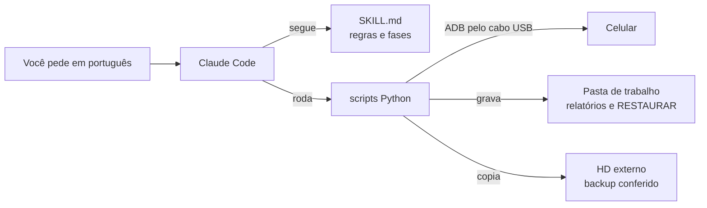

# Xiaomi POCO Otimizador para Claude Code

Uma skill do [Claude Code](https://claude.com/claude-code) que faz um raio-x completo do seu celular
Android pelo computador, explica em português simples por que ele está lento, esquentando ou sem
espaço, e aplica as melhorias com segurança: tudo reversível e nada apagado sem backup conferido.

Foi criada e testada num POCO X5 Pro (HyperOS). Foi pensada para celulares Xiaomi, POCO e Redmi com MIUI
ou HyperOS e também funciona, com menos recursos específicos, em Samsung, Motorola, Pixel, Oppo,
Realme e OnePlus.

**Nunca usou o Claude Code nem o ADB?** Siga o [tutorial passo a passo](TUTORIAL.md). Ele vai do zero,
com a instalação dos programas, até o celular limpo, e explica como a skill funciona por dentro.

> **Aviso:** use por sua conta e risco. A skill evita qualquer operação irreversível no sistema, mas
> mexer em apps de sistema sempre envolve algum risco. Este projeto não tem relação com Xiaomi,
> Samsung, Google ou Anthropic.

## O que ela faz

- **Diagnóstico rápido (1 a 2 minutos):** armazenamento, RAM e swap, bateria, temperatura, CPU
  limitada, desgaste do armazenamento, apps instalados fora da loja e serviços de acessibilidade.
- **Varredura profunda (somente leitura):** coleta configurações, serviços, logs e bugreport, e gera um
  relatório com conclusões e evidências.
- **Investigação de obsolescência programada:** procura código e configurações que limitam
  desempenho, brilho ou carga por idade, ciclos ou nome de app. Separa fato medido de inferência.
- **Política térmica real da Xiaomi:** decodifica o log interno do `mi_thermald` e mostra em que
  temperatura a CPU, a GPU, o brilho e a carga são cortados, e por quanto tempo.
- **Caça a mineradores e apps suspeitos:** análise estática dos APKs instalados fora da loja
  (mineração de cripto, permissões de risco, assinatura caseira, servidores contatados).
- **Apps sem uso:** lista o que não é aberto há meses e marca bancos, carteiras e apps de governo para
  nunca serem removidos sem você confirmar.
- **Debloat reversível:** remove apps de fábrica para o seu usuário (o app volta com um comando).
  Pacotes essenciais, o launcher, o teclado e o WebView em uso são recusados automaticamente.
- **Restrição de segundo plano** para apps pesados, poupando mensagens e bancos.
- **Backup verificado** de fotos, vídeos, documentos e mídias do WhatsApp e do Telegram para o PC ou
  um HD externo, conferido arquivo por arquivo e retomável.
- **Liberação de espaço segura:** apaga do celular só o que tem cópia idêntica no backup e mantém os
  últimos 30 dias (configurável).
- **Estudo da câmera:** câmeras escondidas pelo fabricante, nível Camera2, RAW, estabilização e limites
  de vídeo.

## O que ela não faz

Root, desbloqueio de bootloader, instalação de ROM, reset de fábrica, apagar dados de apps ou apagar
qualquer arquivo sem cópia conferida. Overclock sem root não existe, e a skill explica o porquê e o
que dá para recuperar de desempenho.

## Como funciona



Você conversa com o Claude Code. Ele segue as regras do `SKILL.md` e roda scripts em Python que falam
com o celular pelo ADB, a ferramenta oficial do Android. Primeiro tudo é só leitura; depois vem um
plano, a sua autorização e, só então, a mudança. Os detalhes estão na
[seção "Como funciona por dentro" do tutorial](TUTORIAL.md#11-como-funciona-por-dentro).

## Requisitos

- Computador com Windows 10 ou mais novo, macOS ou Linux, e o
  [Claude Code](https://claude.com/claude-code) (terminal, app desktop ou extensão do VS Code). O Claude
  no navegador não acessa o seu cabo USB, então não serve.
- Conta do Claude com acesso ao Claude Code (Pro, Max, Team, Enterprise ou API). O plano gratuito não
  inclui o Claude Code.
- Python 3.8 ou mais novo. No Windows: `winget install Python.Python.3.12`.
- ADB (Android Platform Tools). Instale assim:
  - Windows: `winget install Google.PlatformTools`
  - macOS: `brew install android-platform-tools`
  - Linux: `sudo apt install adb`. Se aparecer "no permissions", rode também
    `sudo apt install android-sdk-platform-tools-common` e `sudo usermod -aG plugdev $USER`, e entre de novo
    na sessão.
- Cabo USB que transmita dados e celular com Android 8 ou mais novo (recomendado Android 10 ou mais novo).

## Instalação

### Opção 1: como plugin (recomendado)

Dentro do Claude Code, digite:

```
/plugin marketplace add cavaleiro-ai/xiaomi-poco-otimizador
/plugin install xiaomi-poco-otimizador@xiaomi-poco-otimizador
```

Para atualizar depois, rode `/plugin marketplace update xiaomi-poco-otimizador`.

### Opção 2: copiando a pasta da skill

Windows (PowerShell):

```powershell
git clone https://github.com/cavaleiro-ai/xiaomi-poco-otimizador.git
New-Item -ItemType Directory -Force "$env:USERPROFILE\.claude\skills" | Out-Null
Copy-Item -Recurse xiaomi-poco-otimizador\plugins\xiaomi-poco-otimizador\skills\xiaomi-poco-otimizador "$env:USERPROFILE\.claude\skills\"
```

macOS e Linux:

```bash
git clone https://github.com/cavaleiro-ai/xiaomi-poco-otimizador.git
mkdir -p ~/.claude/skills
cp -r xiaomi-poco-otimizador/plugins/xiaomi-poco-otimizador/skills/xiaomi-poco-otimizador ~/.claude/skills/
```

Reinicie o Claude Code depois de copiar.

## Prepare o celular (uma vez)

1. Ative as Opções do desenvolvedor tocando 7 vezes no item certo:
   - Xiaomi: Configurações → Sobre o telefone → **Versão do HyperOS/MIUI**.
   - Samsung: Configurações → Sobre o telefone → Informações do software → **Número de compilação**.
   - Outras marcas: Configurações → Sobre o telefone → **Número da versão**.
2. Abra **Opções do desenvolvedor** e ligue **Depuração USB**. Na Xiaomi, elas ficam em Configurações →
   Configurações adicionais; na Samsung, no fim das Configurações; nas outras, em Configurações → Sistema.
3. Conecte o cabo, escolha **Transferência de arquivos** e toque em **Permitir** na janela de
   depuração, marcando "Sempre permitir".

Se algo não funcionar, a skill mostra o passo a passo da sua marca e resolve os erros mais comuns.

## Como usar

Abra o Claude Code numa pasta de trabalho, conecte o celular e peça em linguagem normal. O
[tutorial](TUTORIAL.md#5-primeiro-uso-diagnóstico-rápido) mostra cada etapa com o que aparece na tela.
Exemplos de pedido:

- "Meu celular está lento e esquentando. Faça um diagnóstico."
- "Faça uma varredura profunda procurando obsolescência programada e gere um relatório."
- "Quero deixar o celular mais rápido e tirar os apps de fábrica inúteis."
- "Faça backup das fotos e do WhatsApp no HD `E:\Backup celular` e libere espaço, mantendo o último mês."
- "Estude a câmera e veja se dá para melhorar a qualidade."

Se a skill não for acionada sozinha, chame com `/xiaomi-poco-otimizador:xiaomi-poco-otimizador` (instalada como
plugin) ou `/xiaomi-poco-otimizador` (instalada na pasta).

Para otimizar o celular, o fluxo segue esta ordem:

1. **Diagnóstico** (só leitura).
2. **Varredura e relatório** (só leitura, de 5 a 60 minutos).
3. **Plano** com o que será feito, o ganho esperado e como desfazer.
4. **Sua autorização.** Nada muda antes dela, e apagar mídias exige uma autorização à parte.
5. **Aplicação**, com registro de tudo e arquivos para desfazer.
6. **Resumo** com os números de antes e depois e os passos que ficam com você.

## Caso real: POCO X5 Pro com quase 3 anos de uso

| Medida | Antes | Depois |
|---|---:|---:|
| Espaço livre | 19 GB (8 %) | 107 GB (47 %) |
| Pacotes ativos para o usuário | 526 | 465 |
| Mídias copiadas e conferidas no HD externo | — | 115 GB, zero falhas |

O que a investigação encontrou:

- A CPU ficava abaixo do máximo em 32 % do tempo. O corte começava com o sensor virtual da Xiaomi a
  apenas 35 °C.
- O brilho era limitado em cerca de 30 % do tempo, a partir de 37 °C.
- A carga caía para cerca de 3 W com a tela acesa e o aparelho morno.
- A bateria estava com cerca de 70 % da capacidade original.
- A RAM vivia saturada: mais de 1 500 apps encerrados por falta de memória em 13 dias.
- Dois apps instalados fora da loja continham mineradores de criptomoeda.
- Não foi encontrado código que degradasse o aparelho por idade ou número de ciclos. A lentidão vinha
  de política térmica agressiva, bateria gasta, armazenamento cheio e RAM saturada.

## Segurança e privacidade

- **Somente leitura até você autorizar.** Os scripts que alteram algo rodam em simulação até
  receberem `--aplicar`.
- **Reversível:** os apps saem com `pm uninstall -k --user 0`, e os dados continuam no aparelho. Apps
  de fábrica voltam com `cmd package install-existing`. De apps que você instalou, a skill guarda uma
  cópia do APK antes de remover, para poder reinstalá-los. Cada alteração gera um arquivo
  `RESTAURAR_*.txt`.
- **Backup antes de apagar:** cada arquivo é conferido pelo tamanho e pela data de modificação ou, se
  você pedir, pelo conteúdo (MD5).
  Conversas do WhatsApp (`Databases`, `Backups`), `Android/data` e `Android/obb` nunca são apagados.
- **Seus dados ficam no seu computador.** A coleta contém lista de apps e logs. Não publique a pasta
  da coleta; o `.gitignore` deste repositório já bloqueia esses arquivos.
- Ao terminar, desligue a Depuração USB.

## Desfazer alterações

```
python <pasta-da-skill>/scripts/restaurar.py RESTAURAR_pacotes_AAAAMMDD_HHMMSS.txt
```

Use `--so <pacote>` para restaurar um app só. Ou peça ao Claude: "restaure os apps que foram
removidos". Para devolver um arquivo ao celular, use
`adb push "<arquivo no backup>" "/sdcard/<pasta original>/"`.

## Estrutura do repositório

```
xiaomi-poco-otimizador/
├── README.md
├── TUTORIAL.md                              # passo a passo do zero, para iniciantes
├── .claude-plugin/marketplace.json          # catálogo para /plugin marketplace add
└── plugins/xiaomi-poco-otimizador/
    ├── .claude-plugin/plugin.json
    └── skills/xiaomi-poco-otimizador/
        ├── SKILL.md                         # instruções que o Claude segue
        ├── references/                      # guias: conexão, diagnóstico, Xiaomi, outras marcas, câmera, modelos
        └── scripts/                         # Python 3, só biblioteca padrão
            ├── verificar_conexao.py         # adb, autorização, identidade do aparelho
            ├── saude_rapida.py              # diagnóstico rápido
            ├── coletar.py                   # varredura completa somente leitura
            ├── analisar_termico_xiaomi.py   # política térmica real (bugreport Xiaomi)
            ├── apps_sem_uso.py              # apps parados, com marcação de sensíveis
            ├── analisar_apks.py             # mineradores, permissões de risco, servidores
            ├── resumo_camera.py             # câmeras, Camera2, câmeras escondidas
            ├── remover_pacotes.py           # debloat reversível com lista de protegidos
            ├── restringir_segundo_plano.py  # restrição reversível de segundo plano
            ├── restaurar.py                 # desfaz a partir dos arquivos RESTAURAR
            ├── backup_midias.py             # backup verificado e retomável
            └── limpar_verificado.py         # apaga só o que tem cópia idêntica
```

Os scripts também funcionam sem o Claude. Rode qualquer um com `--help` para ver como usar; essa opção
não toca no celular.

## Perguntas frequentes

**Preciso de root?** Não. Tudo é feito com as permissões normais do ADB.

**Vou perder a garantia?** Não. Nada no sistema é alterado de forma permanente.

**Os apps de banco continuam funcionando?** Sim. Não há root nem modificação do sistema, e apps
financeiros não são tocados sem a sua confirmação.

**Quanto tempo leva?** O diagnóstico leva de 1 a 2 minutos e a varredura completa, de 20 a 60. O
backup depende do volume: cerca de 100 GB levam algumas horas pelo cabo.

**Funciona no iPhone?** Não, só Android.

## Contribuindo

Relatos de outros modelos são muito bem-vindos: listas de debloat por marca, formatos de log térmico e
correções. Abra uma issue ou um pull request. Não inclua dados pessoais, serial ou IMEI.

## Licença

[MIT](LICENSE)
