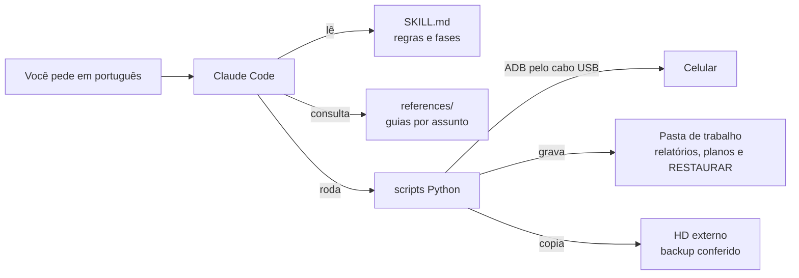

# Tutorial passo a passo

Este guia leva você do zero até um celular diagnosticado, mais rápido e com espaço livre. Não é preciso
saber programar: você conversa com o Claude em português e ele roda os comandos por você, pedindo
permissão antes de cada um. A preparação leva cerca de 30 minutos na primeira vez.

## Sumário

1. [O que você precisa](#1-o-que-você-precisa)
2. [Instale os programas no computador](#2-instale-os-programas-no-computador)
3. [Instale a skill](#3-instale-a-skill)
4. [Prepare o celular](#4-prepare-o-celular)
5. [Primeiro uso: diagnóstico rápido](#5-primeiro-uso-diagnóstico-rápido)
6. [Relatório completo](#6-relatório-completo)
7. [Deixe o celular mais rápido](#7-deixe-o-celular-mais-rápido)
8. [Faça backup e libere espaço](#8-faça-backup-e-libere-espaço)
9. [Desfaça o que quiser](#9-desfaça-o-que-quiser)
10. [Termine com segurança](#10-termine-com-segurança)
11. [Como funciona por dentro](#11-como-funciona-por-dentro)
12. [Use os scripts sem o Claude](#12-use-os-scripts-sem-o-claude)
13. [Problemas comuns](#13-problemas-comuns)

## 1. O que você precisa

- **Computador** com Windows 10 ou mais novo, macOS ou Linux.
- **Conta do Claude com acesso ao Claude Code:** planos Pro, Max, Team ou Enterprise, ou uma conta da
  API da Anthropic (Console). O plano gratuito não inclui o Claude Code.
- **Cabo USB que transmita dados.** Muitos cabos baratos só carregam. O cabo original costuma funcionar.
- **Celular Android 8 ou mais novo**, com mais de 50 % de bateria ou carregando.
- **Só para liberar espaço:** um HD externo, ou espaço livre no computador, maior que o volume de fotos
  e vídeos do celular. O disco precisa estar em NTFS ou exFAT. FAT32 não aceita arquivos de 4 GB ou
  mais, como vídeos longos.

## 2. Instale os programas no computador

Você vai instalar três programas: o Claude Code, o Python e o ADB, a ferramenta oficial do Android que
conversa com o celular pelo cabo.

### Windows

Abra o PowerShell: aperte a tecla Windows, digite `PowerShell` e tecle Enter. Cole uma linha de cada
vez e tecle Enter:

```powershell
irm https://claude.ai/install.ps1 | iex
winget install Python.Python.3.12
winget install Google.PlatformTools
winget install Git.Git
```

O Git é opcional, mas recomendado: com ele o Claude Code usa o terminal Bash, onde a skill foi mais
testada.

### macOS

Abra o Terminal. Se ainda não tiver o Homebrew, instale-o antes pelo site [brew.sh](https://brew.sh).

```bash
curl -fsSL https://claude.ai/install.sh | bash
brew install python android-platform-tools
```

### Linux (Debian, Ubuntu e derivados)

```bash
curl -fsSL https://claude.ai/install.sh | bash
sudo apt install python3 adb
```

### Confira a instalação

Feche o terminal e abra outro, para ele enxergar os programas novos. Depois rode:

```
claude --version
python --version
adb version
```

Cada comando deve mostrar um número de versão. No macOS e no Linux, use `python3 --version`. Se algum
falhar, veja a seção [Problemas comuns](#13-problemas-comuns).

### Entre na sua conta

Digite `claude` e tecle Enter. Na primeira vez, ele abre o navegador para você entrar na sua conta do
Claude. Depois disso, o Claude Code fica pronto no terminal.

Se preferir uma janela em vez do terminal, o Claude Code também existe como app para Windows e macOS e
como extensão do VS Code. Os passos deste tutorial valem para todos.

## 3. Instale a skill

Com o Claude Code aberto, digite estas duas linhas, uma de cada vez:

```
/plugin marketplace add cavaleiro-ai/xiaomi-poco-otimizador
/plugin install xiaomi-poco-otimizador@xiaomi-poco-otimizador
```

A primeira linha cadastra este repositório como fonte de plugins. A segunda instala a skill.

Para conferir, digite `/xiaomi` e veja se aparece `/xiaomi-poco-otimizador:xiaomi-poco-otimizador` nas
sugestões. Se não aparecer, feche o Claude Code com `/exit` e abra de novo.

Para atualizar no futuro, rode `/plugin marketplace update xiaomi-poco-otimizador`.

## 4. Prepare o celular

Isso só precisa ser feito uma vez.

1. **Ligue as Opções do desenvolvedor.** Toque 7 vezes no item certo, até aparecer "Você agora é um
   desenvolvedor":
   - Xiaomi, POCO, Redmi: Configurações → Sobre o telefone → **Versão do HyperOS** (ou **Versão do MIUI**).
   - Samsung: Configurações → Sobre o telefone → Informações do software → **Número de compilação**.
   - Motorola, Pixel e outros: Configurações → Sobre o telefone → **Número da versão**.
2. **Ligue a Depuração USB.** Abra as Opções do desenvolvedor e ligue **Depuração USB**.
   - Xiaomi: Configurações → Configurações adicionais → Opções do desenvolvedor.
   - Samsung: no fim da lista de Configurações.
   - Outras marcas: Configurações → Sistema → Opções do desenvolvedor.
3. **Só na Xiaomi, opcional:** ligue também **Depuração USB (configurações de segurança)**. Ela pede
   uma conta Xiaomi conectada e um chip no celular. Sem ela, a skill faz quase tudo; só alguns ajustes,
   como a velocidade das animações, passam a ser feitos por você na tela, com o Claude dizendo onde
   tocar.
4. **Conecte o cabo.** Desbloqueie o celular e, na notificação de USB, escolha **Transferência de
   arquivos**.
5. **Autorize o computador.** Vai aparecer "Permitir depuração USB?". Marque **Sempre permitir deste
   computador** e toque em **Permitir**.

Se a janela do passo 5 não aparecer, não tem problema: o Claude confere a conexão e diz o que falta,
com os nomes de menu da sua marca.

## 5. Primeiro uso: diagnóstico rápido

1. **Crie uma pasta de trabalho e abra o Claude Code nela.** É ali que ficam relatórios, registros e
   arquivos para desfazer.

   Windows (PowerShell):

   ```powershell
   mkdir $HOME\celular
   cd $HOME\celular
   claude
   ```

   macOS e Linux:

   ```bash
   mkdir ~/celular && cd ~/celular && claude
   ```

2. **Peça o diagnóstico** em linguagem normal, por exemplo:

   > Meu celular está lento e esquentando. Faça um diagnóstico.

3. **Aprove os comandos.** Antes de rodar qualquer comando, o Claude Code mostra o que vai executar e
   pede sua permissão. Leia e aprove. Se preferir, permita aquele tipo de comando para não ser
   perguntado de novo na mesma sessão.

4. **Veja o resultado.** Primeiro o Claude confere a conexão e identifica o aparelho. Em 1 a 3 minutos,
   ele mostra um resumo em português com alertas sobre:
   - espaço livre e desgaste do armazenamento;
   - RAM, swap e apps encerrados por falta de memória;
   - saúde e temperatura da bateria;
   - CPU limitada pelo calor;
   - apps instalados fora da loja e serviços de acessibilidade ativos.

   O resumo também fica salvo em `analise/diagnostico_rapido.md`, dentro da pasta de trabalho.

Um exemplo resumido de resposta, com números do caso real descrito no README:

> Conectei ao POCO X5 Pro (HyperOS, Android 14). Principais achados: o armazenamento está 92 % cheio,
> a bateria está com cerca de 70 % da capacidade original, e há 2 apps instalados fora da loja que
> merecem análise. Quer que eu faça a varredura completa para entender o aquecimento?

Nada é alterado nesta etapa.

## 6. Relatório completo

Peça:

> Faça uma varredura completa e gere um relatório.

O que acontece:

- A coleta é somente leitura e leva de 20 a 60 minutos. A parte mais lenta é o relatório de bugs do
  Android, que inclui o log térmico da Xiaomi.
- O Claude analisa:
  - em que temperatura a CPU, o brilho e a carga são cortados;
  - se há apps com mineradores de criptomoeda ou permissões de risco;
  - quais apps você não abre há meses;
  - se há sinais de obsolescência programada.
- Você recebe o arquivo `RELATORIO_<modelo>_<data>.md`, com as conclusões, as evidências e o que dá
  para fazer.

A pasta `coleta/` guarda os dados brutos: lista de apps, configurações e logs. **Não publique essa
pasta.** Se quiser compartilhar o relatório num fórum, apague antes o serial, o IMEI e os nomes de
contas.

## 7. Deixe o celular mais rápido

1. **Peça o plano:**

   > Quero deixar o celular mais rápido e tirar os apps de fábrica que não servem para nada.

2. **Leia o plano.** O Claude grava um `PLANO_<data>.md` com:
   - os apps de fábrica que podem sair, separados em níveis:
     - **Nível 1:** anúncios, telemetria e instaladores duplicados. Seguro.
     - **Nível 2:** apps cuja remoção tira uma função, como o Mi Cloud, a bola flutuante ou o ShareMe.
       Só saem se você não usa.
     - **Nível 3:** essenciais. Nunca saem.
   - apps pesados que podem ser restringidos em segundo plano;
   - animações mais rápidas e limpeza de cache;
   - o ganho esperado e como desfazer cada item.

3. **Diga o que pode ser feito.** Nada muda antes da sua resposta. Por exemplo:

   > Pode aplicar o nível 1 e as animações. Não mexa na Galeria.

4. **Acompanhe a aplicação.** O Claude roda primeiro uma simulação, mostra o resultado e só então
   aplica. Tudo fica registrado em `execucao/`, junto com os arquivos `RESTAURAR_*.txt`.

5. **Use o celular por um dia** antes de partir para o nível 2. Se algo fizer falta, veja a seção
   [Desfaça o que quiser](#9-desfaça-o-que-quiser).

O que a skill recusa sozinha:

- pacotes essenciais do sistema;
- o launcher, o teclado e o WebView em uso;
- bancos, carteiras de cripto, apps de governo, autenticadores e apps da empresa, a menos que você
  confirme um por um.

Os apps saem só para o seu usuário. Os apps de fábrica continuam guardados na parte do sistema e
voltam com um comando. Dos apps que você mesmo instalou, a skill guarda uma cópia do APK antes de
remover.

## 8. Faça backup e libere espaço

1. **Conecte o HD externo** e veja a letra dele no Windows, por exemplo `E:`.

2. **Peça:**

   > Faça backup das fotos, vídeos e do WhatsApp no HD em E:\Backup celular e libere espaço,
   > mantendo os últimos 30 dias no celular.

3. **Confira a estimativa.** O Claude mostra quanto vai ser copiado e se cabe no destino. Ele avisa se
   o disco for FAT32.

4. **Espere a cópia terminar.** São cerca de 100 GB em algumas horas pelo cabo. Deixe o celular
   carregando e impeça o computador de entrar em suspensão. Se a cópia cair, peça de novo: ela continua
   de onde parou. O backup fica no HD com as mesmas pastas do celular.

5. **Veja a conferência.** Cada arquivo é conferido pelo tamanho e pela data. O Claude só segue se o
   resumo disser `falhas de cópia: 0`.

6. **Leia a tabela do que será apagado.** Ela traz, por pasta, quantos arquivos e quantos GB saem do
   celular. Antes de apagar, o Claude repete o aviso do WhatsApp: a foto ou o vídeo apagado continua
   aparecendo como miniatura na conversa, mas não abre mais no celular. O original fica no seu backup.

7. **Autorize.** Só depois que você responder algo como "pode apagar", o Claude apaga, e mostra o
   espaço livre antes e depois.

O que nunca é apagado:

- as conversas do WhatsApp (`Databases` e `Backups`);
- `Android/data` e `Android/obb`, onde ficam dados de apps e jogos;
- arquivos dos últimos 30 dias, ou o número de dias que você escolher;
- qualquer arquivo sem uma cópia idêntica conferida no backup.

## 9. Desfaça o que quiser

O jeito mais fácil é pedir ao Claude, aberto na mesma pasta de trabalho:

> Restaure o app da Galeria.

> Desfaça tudo o que foi feito hoje.

Também dá para fazer à mão, com o repositório baixado. Veja na seção 12 o que é `<scripts>`.

```
python <scripts>/restaurar.py execucao/RESTAURAR_pacotes_AAAAMMDD_HHMMSS.txt
```

Acrescente `--so <nome.do.pacote>` para restaurar um app só.

Para devolver um arquivo do backup ao celular:

```
adb push "E:\Backup celular\DCIM\Camera\foto.jpg" "/sdcard/DCIM/Camera/"
```

## 10. Termine com segurança

1. No celular, desligue a **Depuração USB**.
2. Na Xiaomi, desligue também a **Depuração USB (configurações de segurança)**.
3. Guarde a pasta de trabalho, com o relatório e os arquivos `RESTAURAR_*.txt`, e o HD com o backup.

Com a depuração ligada, qualquer computador que você já autorizou consegue controlar o aparelho.

## 11. Como funciona por dentro



- **Skill** é um pacote de instruções que o Claude Code carrega quando o assunto combina. Esta tem três
  partes:
  - `SKILL.md`: as regras e as fases que o Claude segue;
  - `references/`: guias de consulta sobre conexão, diagnóstico, Xiaomi, outras marcas, câmera e modelos
    de relatório;
  - `scripts/`: programas em Python que fazem o trabalho pesado.
- **Os scripts falam com o celular pelo ADB**, a ferramenta oficial do Android para desenvolvedores. Não
  há root nem app instalado no celular.
- **A ordem é sempre a mesma:** primeiro só leitura, depois o plano, depois a sua autorização e só então
  a mudança.

Cada camada de segurança e o que ela evita:

| Camada | O que evita |
|---|---|
| Os scripts que alteram algo rodam em simulação até receberem `--aplicar` | Mudança sem você ver antes |
| Listas de pacotes protegidos e detecção do launcher, do teclado e do WebView em uso | Celular sem tela inicial ou sem teclado |
| Bancos, governo e autenticadores só saem com confirmação item a item | Perder o acesso ao banco na hora de pagar |
| Remoção com `pm uninstall -k --user 0` e cópia do APK de apps instalados por você | App removido sem volta |
| Arquivo `RESTAURAR_*.txt` para cada mudança | Não lembrar o que foi feito |
| Conferência por tamanho e data, ou por MD5, antes de apagar | Apagar foto sem cópia boa |
| Autorização separada para apagar mídia | Apagar por entender "libere espaço" como permissão |

## 12. Use os scripts sem o Claude

Os scripts usam só a biblioteca padrão do Python e funcionam sozinhos. Baixe o repositório:

```
git clone https://github.com/cavaleiro-ai/xiaomi-poco-otimizador.git
```

Os scripts ficam em `xiaomi-poco-otimizador/plugins/xiaomi-poco-otimizador/skills/xiaomi-poco-otimizador/scripts/`.
Nos exemplos abaixo, troque `<scripts>` pelo caminho completo dessa pasta.

Rode os comandos a partir da sua pasta de trabalho, não da pasta do repositório, para que os seus dados
não se misturem com o código. Qualquer script aceita `--help`, que mostra as opções e não toca no
celular.

```
python <scripts>/verificar_conexao.py
python <scripts>/saude_rapida.py --saida diagnostico.md
python <scripts>/remover_pacotes.py --lista minha_lista.txt
python <scripts>/backup_midias.py --destino "E:\Backup celular" --padrao --listar
python <scripts>/limpar_verificado.py --destino "E:\Backup celular" --origem /sdcard/DCIM --dias 30
```

Os três últimos só mostram o que fariam. Para executar de verdade, acrescente `--aplicar` no
`remover_pacotes.py` e no `limpar_verificado.py`, ou tire o `--listar` do `backup_midias.py`. A
lista de remoção é um arquivo de texto com um nome de pacote por linha.

## 13. Problemas comuns

| O que aparece | O que fazer |
|---|---|
| `claude`, `python` ou `adb` "não é reconhecido" | Feche o terminal e abra outro. Se continuar, repita a instalação do programa |
| `python` abre a Microsoft Store | Use `py` no lugar de `python`, ou desligue os atalhos do Python em Configurações → Aplicativos → Aliases de execução de aplicativo |
| O Claude Code diz que o plano não dá acesso | O plano gratuito não inclui o Claude Code; veja a seção 1 |
| O Claude não usa a skill | Chame direto com `/xiaomi-poco-otimizador:xiaomi-poco-otimizador` e depois descreva o pedido |
| O celular não aparece | Troque o cabo ou a porta USB, escolha "Transferência de arquivos" e desligue e religue a Depuração USB. No Windows, pode faltar o driver USB do fabricante |
| `unauthorized` | Desbloqueie o celular e toque em **Permitir** na janela de depuração |
| `no permissions` (Linux) | Rode os comandos que o Claude mostrar e entre de novo na sessão |
| `WRITE_SECURE_SETTINGS` ou `INJECT_EVENTS` (Xiaomi) | Falta a Depuração USB (configurações de segurança). Ligue-a ou faça o ajuste pela tela, com o Claude dizendo onde tocar |
| `Failure [-1000]` ao remover um app | O fabricante bloqueia a remoção. A skill desativa o app no lugar, o que também é reversível |
| A cópia parou no meio | Peça de novo: ela continua de onde parou. Desative a suspensão do computador e a suspensão seletiva de USB do Windows |
| O HD não aceita arquivos grandes | O disco está em FAT32. Use outro disco, ou formate-o em exFAT, o que apaga tudo o que há nele |

Ainda com dúvida? Abra uma [issue](https://github.com/cavaleiro-ai/xiaomi-poco-otimizador/issues) com o
modelo do celular e a mensagem de erro, sem serial, IMEI ou dados pessoais.
